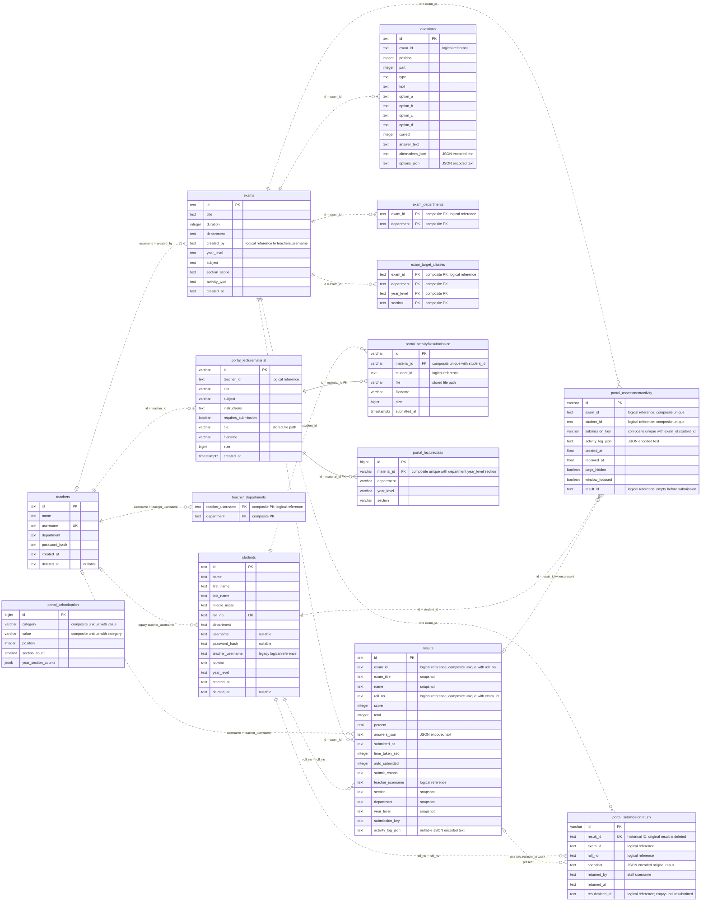

# AralHub entity relationship diagram

Based on the current application schema through migration `0019_assessment_activity_monitor` (12 November 2026). This documents the schema defined in source; it does not verify the migration state of a running database.

## Reading the diagram

- `PK`: primary key; multiple PK fields in one table form a composite primary key.
- `UK`: a single-column unique constraint. Composite unique constraints are described in field comments and below.
- `FK`: a database-enforced foreign key. Only the two `material_id` fields have declared foreign keys in the application schema.
- Solid lines show declared foreign keys; dotted lines show logical references maintained by application code. This line style is a documentation convention, not a claim about identifying relationships.
- `||` means one, `|o` means zero or one, and `o{` means zero or many. Logical cardinalities describe intended application associations; missing or historical records can leave those references unresolved.
- Actual database table names are used. Types reflect PostgreSQL storage broadly; varchar lengths, defaults, nullability, and check constraints are not exhaustively displayed.

## Diagram

## Constraints and implementation notes

| Table | Composite unique columns |
| --- | --- |
| `results` | `exam_id`, `roll_no` |
| `portal_schooloption` | `category`, `value` |
| `portal_lectureclass` | `material_id`, `department`, `year_level`, `section` |
| `portal_activityfilesubmission` | `material_id`, `student_id` |
| `portal_assessmentactivity` | `exam_id`, `student_id`, `submission_key` |

- `teachers.username` identifies assessment creators and teacher department assignments. Lecture materials instead reference `teachers.id`.
- Results reference students by the unique `students.roll_no`; file submissions and assessment monitoring reference `students.id`.
- Returning a submission copies its original result into `portal_submissionreturn.snapshot`, records the original `result_id`, and deletes the original row from `results`. For that reason, the historical `result_id` is not drawn as a live relationship. `resubmitted_id` can later identify a replacement result.
- `returned_by` records a staff username. Staff can include administrators, so it is not presented as a mandatory teacher relationship.
- Assessment and lecture access use matching `department`, `year_level`, and `section` values. There is no independent class entity or class foreign key. `students.teacher_username` is a legacy field, not the current enrollment mechanism.
- `portal_schooloption` stores configurable department values and section counts. These values are used by application validation, without a declared foreign key from department columns. Legacy scope fields can also contain `ALL` or an empty value, so this table is intentionally shown independently.
- Answers, question alternatives, return snapshots, and activity logs stored in text columns contain JSON; they are not separate relational tables. Uploaded files are stored outside the database; their paths and metadata are stored here.
- Framework tables for Django authentication, permissions, sessions, content types, admin logs, and migration history are outside this application ERD. Removed tables `student_teachers` and `portal_activitysubmissionnotification` are excluded.

## Sources

- [Core schema and compatibility additions](../portal/db.py)
- [Assessment target class schema](../portal/targets.py)
- [Current Django models](../portal/models.py)
- [Schema migrations](../portal/migrations/)
- [Submission return lifecycle](../portal/submissions.py)

Editable Mermaid source: [ERD.mmd](ERD.mmd).
